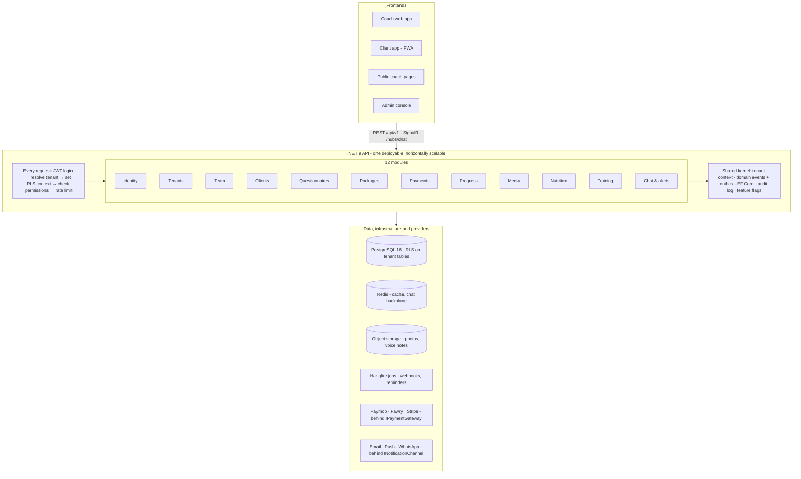

# CoachDB Backend PRD

Oct 25, 2026 · @Ahmed

The backend is a .NET 9 modular monolith on PostgreSQL 16 that serves every coach from one deployment. It exposes a versioned REST API and a SignalR hub to the Vue apps, and enforces each coach's data isolation in both the API and the database. The database schema (36 tables) is already designed and tested; this PRD covers everything built on top of it.

## Goals, non-goals and success measures

The backend must let a coach run his whole business (selling packages, collecting payment, onboarding, nutrition, training, check-ins and chat) while never exposing one coach's data to another.

**Goals**

- One deployment serves every coach (multi-tenant SaaS), from a solo coach to a gym with several coaches.
- A clean, versioned REST API (`/api/v1`) documented with OpenAPI, so the Vue apps and a future mobile app use the same contract.
- Business rules live in one place per module and are also enforced by the database (photos only after payment, training only on training packages).
- Payments work for Egypt first (Paymob, Fawry) and abroad later (Stripe) without changing the core code.
- New features, payment providers, question types or package types can be added without rewriting existing modules (see *Built for change*).

**Non-goals for v1**

- Native mobile apps (the client app is a PWA; the API is ready for native later).
- Video calls, AI meal or workout generation, wearable sync (Apple Health, Garmin). These are listed as later phases.
- Microservices. The system starts as one modular application and can split later.

**Success measures**

| Measure | Target |
| --- | --- |
| Cross-tenant data leaks | 0, verified by automated isolation tests on every build |
| API response time | 95% of requests under 300 ms at 1,000 active coaches |
| Payment accuracy | Every successful gateway payment matched to exactly one subscription |
| Uptime | 99.5% monthly |
| Time to add a new payment provider | One new class plus configuration, no changes to other modules |

## Users and roles

Five roles. A person has one login and can hold different roles in different tenants (a coach at his own business, a client at another coach's). Permissions are checked per tenant, from the role in `tenant_members` or `clients`.

| Capability | Platform admin | Owner | Coach | Assistant | Client |
| --- | --- | --- | --- | --- | --- |
| Manage SaaS plans, see all tenants | yes |  |  |  |  |
| Business settings, branding, payout account |  | yes |  |  |  |
| Invite and remove team members |  | yes |  |  |  |
| Create and edit packages and prices |  | yes | yes |  |  |
| Build questionnaires |  | yes | yes | yes |  |
| See all clients of the business |  | yes | assigned only by default | assigned only |  |
| Write nutrition plans and workout programs |  | yes | yes | draft only |  |
| Review check-ins, give scores |  | yes | yes |  |  |
| Chat with clients |  | yes | yes | yes | own thread |
| See revenue and payouts |  | yes | own clients |  |  |
| Buy a package, pay, cancel |  |  |  |  | yes |
| Submit check-ins, photos, logs |  |  |  |  | yes |
| Export or delete own data |  | yes (business) |  |  | yes (own) |

Roles are mapped to named **permissions** (for example `plans.write`, `checkins.review`), not checked by role name in code. Changing what a role can do is a configuration change, and a custom role can be added later without touching endpoints.

## Architecture

The backend is a **modular monolith**: one application to build, deploy and debug, split inside into modules with strict boundaries. It is far cheaper to run and change than microservices at this stage, and any module can be moved into its own service later without rewriting it.

Inside each module the code follows Clean Architecture: **API** (endpoints, request validation) → **Application** (use cases as commands and queries) → **Domain** (entities and rules, no framework code) → **Infrastructure** (EF Core, external providers). Rules live in the Domain layer, so they are tested without a database or web server.

| Concern | Choice | Why |
| --- | --- | --- |
| Runtime | .NET 9, ASP.NET Core Minimal APIs | Fast, long-term supported, one endpoint file per feature |
| Database | PostgreSQL 16 via EF Core 9 + Npgsql | The tested schema; RLS for isolation |
| Use cases | MediatR-style commands and queries, FluentValidation | Each feature is one small, testable class |
| Auth | ASP.NET Core Identity, JWT + refresh tokens, Google login | Standard, secure, no vendor lock-in |
| Real-time | SignalR (Redis backplane when scaled out) | Chat and live dashboard badges |
| Jobs | Hangfire on PostgreSQL | No extra infrastructure; retries and a dashboard built in |
| Cache | Redis | Package lists, food search, rate-limit counters |
| Files | S3-compatible or Azure Blob, signed URLs | Photos never pass through the API servers |
| Payments | Paymob, Fawry (Egypt), Stripe (international) | Behind one interface |
| Observability | Serilog, OpenTelemetry, Seq or Grafana | Every log line carries tenant and request id |
| Delivery | Docker, GitHub Actions, staging + production | Automatic tests, migrations and deploy on merge |

## Multi-tenancy: how each request is tied to one coach

Every request is resolved to exactly one tenant before any business code runs, and the database refuses to show anything else.

1. **Find the tenant.** In this order: the subdomain (`fitwithahmed.coachdb.app`), a custom domain mapped in `tenants.settings`, or the `X-Tenant` header used by the client app when a person belongs to several coaches.
2. **Check membership.** The JWT identifies the user. Middleware confirms the user is a member or client of that tenant and loads their permissions. No membership = `403`.
3. **Set the context.** A scoped `ITenantContext` holds the tenant id. An EF Core connection interceptor runs `SELECT set_config('app.tenant_id', @id, true)` at the start of every transaction, which switches on Row-Level Security in Postgres.
4. **Filter twice.** EF Core global query filters add `tenant_id = @current` to every query, and new entities get `tenant_id` stamped automatically on save. RLS catches anything the filters miss.
5. **Connect safely.** The API uses the restricted `app_user` database role. Migrations and cross-tenant jobs (webhooks, renewals) use a separate role that bypasses RLS and run outside the request pipeline.

Automated tests run on every build: they create two tenants and assert that every endpoint returns `404` or an empty list for the other tenant's ids, and that the database refuses cross-tenant writes.

## Functional requirements and API endpoints

Twelve modules. Each owns its tables, endpoints and rules. All routes start with `/api/v1`; list endpoints support paging (`?cursor=&limit=`), sorting and filtering. Errors use one format (RFC 7807 problem details) with a stable `code` the frontend can act on, such as `subscription_required` or `plan_limit_reached`.

| Module | What it does | Main endpoints |
| --- | --- | --- |
| **Identity** | Sign-up, login (email + password, Google), email verification, password reset, refresh tokens, sessions | `POST /auth/register` · `/auth/login` · `/auth/refresh` · `/auth/forgot` · `GET /me` |
| **Tenants & billing to the platform** | Create a coaching business, trial, SaaS plan, branding, domain, plan limits (max clients) | `POST /tenants` · `GET/PATCH /tenant` · `GET /tenant/plan` · `POST /tenant/plan/checkout` |
| **Team** | Invite by email, accept invite, change role, disable member | `GET/POST /team` · `PATCH /team/{id}` · `POST /invites/{token}/accept` |
| **Clients** | Client list with search and status filters, profile, assign coach, private notes, pause, archive | `GET /clients?status=&coach=` · `GET/PATCH /clients/{id}` · `POST /clients/{id}/assign` |
| **Questionnaires** | Build forms with 9 question types, reorder, archive questions, collect and read answers | `GET/POST /questionnaires` · `PUT /questionnaires/{id}/questions` · `POST /responses` · `GET /clients/{id}/responses` |
| **Packages & subscriptions** | Create packages, public price list, subscribe, pause, cancel, renew, upgrade (nutrition → nutrition + training) | `GET/POST /packages` · `GET /public/{slug}/packages` · `POST /subscriptions` · `POST /subscriptions/{id}/cancel` |
| **Payments** | Checkout session, gateway webhooks, refunds, coach revenue and payouts, receipts | `POST /payments/checkout` · `POST /webhooks/{provider}` · `POST /payments/{id}/refund` · `GET /revenue?month=` |
| **Progress** | Weekly check-ins, coach review and score, progress photos, measurements, daily logs, photo comparison | `POST /check-ins` · `PATCH /check-ins/{id}/review` · `GET /check-ins?status=submitted` · `POST /daily-logs` |
| **Media** | Signed upload URLs straight to S3/Blob, thumbnails, signed download URLs that expire | `POST /media/upload-url` · `POST /media/{id}/complete` · `GET /media/{id}/url` |
| **Nutrition** | Food library search, coach foods, plans with macro targets, meals and items, templates, copy plan to client, food logs, daily adherence | `GET /foods?q=` · `POST /nutrition-plans` · `POST /nutrition-plans/{id}/copy` · `POST /nutrition-logs` · `GET /clients/{id}/nutrition/adherence` |
| **Training** | Exercise library, programs, days, exercises with sets/reps/RPE/rest/tempo, templates, sessions, set logs, personal records and strength charts | `GET /exercises?q=` · `POST /workout-programs` · `POST /sessions` · `POST /sessions/{id}/sets` · `GET /clients/{id}/strength?exercise=` |
| **Chat & notifications** | Conversations, messages with images and voice notes, read receipts, unread counts, in-app + push + email notifications, per-user preferences | `GET /conversations` · `GET/POST /conversations/{id}/messages` · `POST /conversations/{id}/read` · SignalR `/hubs/chat` |

Also: a **dashboard** endpoint for the coach (`GET /dashboard`: clients needing review, expiring subscriptions, unread messages, monthly revenue) and a **platform admin** API (`/admin/tenants`, `/admin/plans`, `/admin/metrics`) protected by the platform-admin role.

**Rules every module follows**

- Package features are checked on the server: training endpoints return `403 subscription_required` if the client's active subscription doesn't include training. The database enforces the same rule as a backstop.
- Price, features and duration are copied into the subscription at purchase, so editing a package never changes what existing clients bought.
- Plans and programs are never hard-deleted while a client has used them; they are archived.
- Every write to plans, programs, check-in reviews, payments and team roles is recorded in `audit_logs` (who, what, before/after).

## Background jobs and real-time

Work that doesn't belong in a request runs as background jobs (Hangfire on PostgreSQL storage, so no extra infrastructure). Every job is idempotent: running it twice has the same effect as once.

| Job | When | What it does |
| --- | --- | --- |
| Process payment webhook | On each gateway call | Verify signature, store the raw event once, mark the payment, activate the subscription, notify the coach, open the chat |
| Renewal reminders | Daily 09:00 tenant time | Remind clients whose subscription ends in 7, 3 and 1 days |
| Expire subscriptions | Hourly | Set ended subscriptions to `expired`, lock training and photo uploads, notify both sides |
| Check-in reminders | Daily, per package interval | Remind clients whose check-in is due; tell the coach who is overdue |
| Image processing | After each upload | Make thumbnails, strip location data from photos, check file type and size |
| Outbox dispatcher | Every few seconds | Publish domain events (for example `SubscriptionActivated`) to notifications, email and push reliably |
| Platform billing | Daily | Charge coaches for their SaaS plan, enforce trial end and client limits |
| Data export / deletion | On request | Build a ZIP of a client's data, or anonymise it after the legal retention period |

**Real-time.** A SignalR hub pushes new messages, typing and read receipts to open chats, and live badges (new check-in, new message) to the coach dashboard. Connections join a group per conversation and per tenant, and authorisation is checked on join. With several API servers, SignalR uses a Redis backplane.

## Non-functional requirements

| Area | Requirement |
| --- | --- |
| **Authentication** | ASP.NET Core Identity on the `users` table. Short-lived JWT access tokens (15 min) and rotating refresh tokens (30 days) in an HttpOnly cookie for the web apps. Optional 2FA for owners. |
| **Authorisation** | Permission-based policies per endpoint; tenant membership checked on every request; resource checks (a coach sees only assigned clients unless he has `clients.read_all`). |
| **Data protection** | TLS everywhere. Progress photos in a private bucket, served only through signed URLs that expire in 10 minutes. Medical notes encrypted at column level. Secrets in a vault (Azure Key Vault or AWS Secrets Manager), never in config files. |
| **Abuse protection** | Rate limits per IP and per user (login: 5/min; API: 300/min). Webhook signatures verified for every provider. File uploads limited to images and short audio, 15 MB max. |
| **Performance** | p95 under 300 ms for reads, under 500 ms for writes, at 1,000 coaches and 50,000 clients. Cursor paging everywhere; no endpoint returns unbounded lists. Hot reads (package lists, food search) cached in Redis. |
| **Scalability** | Stateless API servers behind a load balancer; scale horizontally. PostgreSQL with read replica for reports. `messages`, `nutrition_logs` and `workout_set_logs` partitioned by month once they pass ~50 M rows. |
| **Reliability** | 99.5% uptime. Point-in-time database backups kept 30 days, restore tested monthly. Outbox pattern so no event is lost if a step fails. Health checks at `/health/live` and `/health/ready`. |
| **Observability** | Structured logs (Serilog) with tenant id and request id on every line; OpenTelemetry traces and metrics; alerts on error rate, slow queries and failed webhooks. |
| **Privacy** | Client data export and deletion on request; deleted clients are anonymised while keeping the coach's revenue records. Consent captured at sign-up. |
| **Localisation** | API returns error codes, not sentences; the frontend translates. Dates in UTC, shown in the tenant's time zone. Money as decimal with ISO currency. |

## Built for change

The system is designed so that the changes you are most likely to want later are small and local. Four design choices make that possible.

1. **Modules with hard boundaries.** Each module (Nutrition, Training, Payments…) is its own project with its own folder of endpoints, rules and data access. Modules talk to each other only through a small public interface or through domain events, never by reaching into each other's tables. A change inside Training can't break Payments, and any module can later become its own service.
2. **Interfaces at every outside edge.** Payment gateways, file storage, email, SMS, push and the AI features of later phases sit behind interfaces (`IPaymentGateway`, `IFileStorage`, `INotificationChannel`). Swapping or adding a provider means writing one class and registering it.
3. **Configuration over code.** What a SaaS plan includes, what a package includes, tenant settings and branding are data (`platform_plans.features`, `packages`, `tenants.settings`), read at runtime. Feature flags turn new features on per tenant or per plan, so you can ship to a few coaches first.
4. **Events instead of hard-wired chains.** When something happens (`CheckInSubmitted`, `PaymentSucceeded`), the module publishes an event. Notifications, analytics and future features subscribe to it. Adding a reaction never means editing the code that raised the event.

**How common changes are made**

| You want to… | What changes | What stays untouched |
| --- | --- | --- |
| Add a payment provider (e.g. Vodafone Cash) | One `IPaymentGateway` class + its webhook verifier + config | Subscriptions, checkout flow, other providers |
| Add a package type (e.g. “Online group program”) | A new feature flag on `packages` + checks in the modules it unlocks | Payments, existing packages and subscriptions |
| Add a question type (e.g. body-map) | Register the type and its validator in the question-type registry | Existing forms and answers |
| Sell a new SaaS tier with different limits | A new row in `platform_plans` with its `features` JSON | All code |
| Turn a feature on for 10 coaches only | Feature flag scoped to those tenants | Everyone else's experience |
| Send a WhatsApp message when a check-in is reviewed | A new `INotificationChannel` + a subscriber to `CheckInReviewed` | The check-in module |
| Add a new field to check-ins | EF Core migration + DTO field (additive, old apps keep working) | Other endpoints |
| Change a role's permissions | Role-to-permission mapping (configuration) | Endpoints |
| Move file storage from S3 to Azure Blob | Register the other `IFileStorage` implementation | Every module that stores files |
| Split Chat into its own service when it grows | Move the module out; it already talks only via its interface and events | Other modules |

**API evolution.** Changes are additive within `/api/v1`: new fields and endpoints are fine, removing or renaming is not. Breaking changes go into `/api/v2`, and v1 is kept for at least 6 months. The OpenAPI file is generated on every build, and the frontend regenerates its typed API client from it, so a mismatch shows up as a compile error, not a runtime bug.

**Database evolution.** Every schema change is an EF Core migration, reviewed and applied automatically on deploy. Columns are added before they are used and removed only after no code reads them (expand, then contract), so deployments never need downtime.

## Delivery phases

Three phases. Each phase ends with something coaches can use for real, so feedback shapes the next. Sizes are rough estimates for a team of two backend developers and should be re-planned after phase 1.

| Phase | What ships | Rough size |
| --- | --- | --- |
| **0. Foundation** | Solution structure, CI/CD, environments (dev, staging, prod), database migrations from the tested schema, tenant resolution + RLS + isolation tests, logging, error format, OpenAPI | 2–3 weeks |
| **1. MVP: a coach can sell and coach nutrition** | Identity, tenants and trial, team invites, clients, questionnaires, packages, Paymob checkout + webhooks, subscriptions, check-ins with photos and review, nutrition plans with macros and templates, food library, food logs, basic chat, email notifications, coach dashboard | 10–12 weeks |
| **2. Training and growth** | Training programs, sessions, set logs, strength charts, upgrades between packages, Fawry and Stripe, push notifications, renewal and check-in reminder jobs, revenue reports, data export, platform admin console, SaaS billing for coaches | 6–8 weeks |
| **3. Scale and extras** | Custom domains, Redis cache and SignalR backplane, table partitioning, audit log viewer, group programs, WhatsApp notifications, public API keys for integrations, first AI assistant features (draft meal plans) | ongoing |

Phase 1 deliberately includes everything a nutrition coach needs to stop using WhatsApp and spreadsheets. Training lands in phase 2 because it is the largest single module and nutrition-only coaching already proves the business.

## Testing and acceptance criteria

**Test layers**

- **Unit tests** for rules inside each module (macro maths, subscription state changes, permission checks).
- **Integration tests** against a real PostgreSQL in a container (Testcontainers), so RLS, triggers and constraints are tested exactly as in production. This includes the existing schema test suite.
- **Tenant isolation suite**: for every endpoint, two tenants are created and each tries to read and write the other's ids. Any success fails the build.
- **Contract tests**: the generated OpenAPI file is compared with the previous release; a breaking change in `/v1` fails the build.
- **Payment tests** with each provider's sandbox and replayed webhooks, including duplicates and out-of-order events.
- **Load test** before each phase release: 1,000 coaches and 50,000 clients of seeded data, p95 targets checked.

**Phase 1 is accepted when**

- [ ] A coach can sign up, create a package and share a public link in under 10 minutes.
- [ ] A client can pay with Paymob sandbox; the subscription activates within 10 seconds of the webhook, and a replayed webhook changes nothing.
- [ ] A client cannot upload progress photos before payment, through the API or directly in the database.
- [ ] A nutrition plan shows macro percentages that match the grams, and food logs show daily adherence.
- [ ] A check-in with three photos can be submitted, reviewed and scored, and appears in the coach's review inbox until reviewed.
- [ ] Chat messages arrive in under 1 second on an open connection, with correct unread counts.
- [ ] The isolation suite passes for every endpoint.
- [ ] p95 response time under 300 ms in the load test.

## Open questions

- [ ] **Hosting:** Azure or AWS? Affects storage, secrets and managed PostgreSQL choice (the code is provider-neutral either way).
- [ ] **Platform fee:** a percentage of each client payment (5% used in examples), a flat monthly SaaS fee, or both?
- [ ] **Payouts:** does money go straight to the coach's gateway account (split payments), or to the platform first and paid out weekly?
- [ ] **Auto-renewal:** charge saved cards automatically at the end of a subscription, or remind and let the client pay again?
- [ ] **Can one client have two coaches at the same business at once** (for example a nutrition coach and a training coach)? Today a client has one assigned coach per tenant.
- [ ] **Medical data:** do any target markets need specific health-data compliance beyond consent and encryption?
